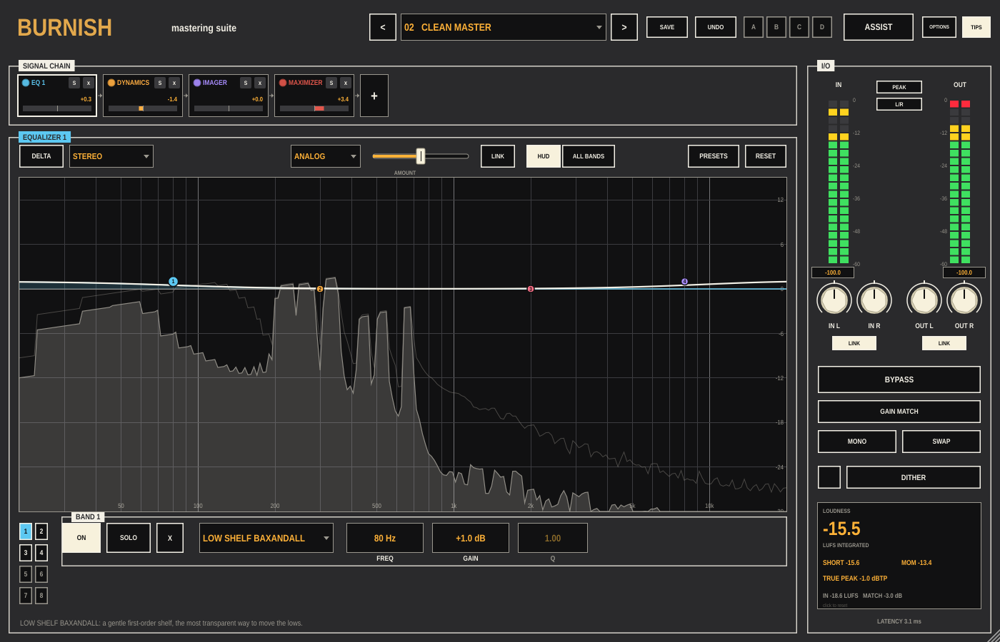

# Burnish

A mastering suite for Ableton Live, built as one VST3. Eighteen modules go
in any order on a signal chain: equalisers (parametric, dynamic, vintage,
match), dynamics (multiband, vintage compressor, vintage limiter, a
Maximizer with multiband limiting, soft clipping and upward compression),
an exciter, a stereo imager with a vectorscope, Impact for microdynamics,
Bass Control, Low End Focus, and three adaptive spectral tools (Clarity,
Stabilizer, Spectral Shaper). Around them: an I/O panel with loudness
metering, gain-matched bypass, dither with noise shaping and a bit meter,
global and per-module presets, undo and four snapshots, and ASSIST, which
listens to the song and builds a chain toward a genre target or a
reference track of your own.

Put it last on the master channel.



The [guide](docs/Burnish-Guide.pdf) (PDF) tours the panel, walks through a
first session in Live, takes every module in turn, and ends with dither
and exporting for streaming, downloads, CD and vinyl.

## The panel

**Header**: PRESET (click for the list, `<` `>` to step, `*` means
changed), SAVE, UNDO (also cmd-Z), snapshots A B C D (click to recall,
shift-click to store), ASSIST, OPTIONS (analyser settings), TIPS.

**SIGNAL CHAIN**: one tile per module in use, in signal order. Click a tile
to show its panel; drag tiles to reorder; the LED is the module's power
switch; S solos it; x removes it; `+` adds one. The bar at the bottom of
each tile is a difference meter: how much the module is changing the level.

**Module panel**: the selected module. Every module has DELTA (hear only
what it changes), PRESETS (for that module alone) and RESET. Most have a
channel mode: STEREO, MID/SIDE or LEFT/RIGHT, with an A and a B set of
controls in the latter two.

**I/O**: input and output meters (PEAK, RMS or LUFS; L/R or M/S; click a
readout to clear a clip), input and output gain with LINK, BYPASS, GAIN
MATCH (the output turned to the input's loudness so BYPASS is a fair
comparison), MONO, SWAP, DITHER (the switch and the panel), and the
loudness readout: integrated, short-term, momentary, true peak, measured
to ITU-R BS.1770 / EBU R128.

## Modules

| Module | What it does |
|---|---|
| **Equalizer 1, 2** | Eight bands, seventeen shapes (bell, proportional Q, band shelf; analog, Baxandall, vintage and resonant shelves; flat, resonant and brickwall passes). ANALOG (minimum phase) or DIGITAL (linear phase, 43 ms latency). AMOUNT scales every band 0-200%. HUD or ALL BANDS view. Drag nodes, double-click to add, alt-click to solo a region. |
| **Dynamic EQ** | Six bands that move with the level in their region: UP or DOWN past a THRESHOLD, with attack and release (AUTO SCALE ties them to the frequency) and a static OFFSET. |
| **Dynamics** | Up to four bands, each a compressor and a limiter on one detector (PEAK, ENV or RMS), with knee, parallel mix and band gain. Negative ratios compress upward or expand. AUTO GAIN, ADAPTIVE RELEASE, a detection filter (high-pass or tilt), LEARN for the crossovers. |
| **Exciter** | Up to four bands of saturation: ANALOG, RETRO, TAPE, TUBE, WARM, TRIODE, DUAL TRIODE; AMOUNT and MIX per band; a post filter on the wet signal; 2x/4x oversampling. |
| **Imager** | Width per band (-100 mono to +100), STEREOIZE for narrow sources (two mono-compatible modes), RECOVER SIDES, and a vectorscope (polar sample, polar level, Lissajous) with correlation and balance. |
| **Impact** | Microdynamics per band: positive opens them up, negative packs them. ENVELOPE in ms or beat divisions (SYNC), AUTO GAIN, STEREO LINK. |
| **Low End Focus** | CONTRAST in a 20-300 Hz region: positive sharpens transients and clears what sits under them, negative blurs. PUNCHY or SMOOTH. |
| **Clarity** | Contours the spectrum toward noise with a chosen TILT, within +-6 dB, with attack and release, in an action region from 300 Hz up. |
| **Stabilizer** | Corrects toward a genre tonal-balance target (SHAPE, loudness neutral) or only cuts resonances above it (CUT), with speed, smoothing, sensitivity and low/mid/high amounts. |
| **Spectral Shaper** | Attenuates narrow peaks that stick out of the spectral envelope in an action region, with attack and release and a TONE tilt. |
| **Match EQ** | Captures the average spectrum of a reference and of your track and applies the smoothed difference, linear phase, between two cutoffs. The reference snapshot is saved with presets. |
| **Maximizer** | GAIN into a true-peak look-ahead limiter; OUTPUT LEVEL ceiling; six modes (LOW LATENCY, I, II, III with four styles, IV with three, V multiband); CHARACTER speed; UPWARD COMPRESS; SOFT CLIP (4x oversampled, three knees); TRANSIENT EMPHASIS; STEREO INDEPENDENCE for transients and sustain; LEARN GAIN to a target loudness. |
| **Vintage Compressor** | A feedback compressor with a detection filter in the loop (high-pass, high shelf or wide boost), SHARP, BALANCED or SMOOTH, with a release that slows for sustained compression. |
| **Vintage EQ** | Two rows of passive-program-style equalisation: a low shelf that boosts and cuts at once, a high peak with bandwidth, a high cut, and three mid peaks whose width follows their gain. Stepped frequencies. |
| **Vintage Limiter** | A variable-mu-style program limiter (ANALOG, TUBE, MODERN) then a brickwall at the CEILING. THRESHOLD down means louder. |
| **Vintage Tape** | Head bump and top-end reach by SPEED (7.5, 15, 30 ips), INPUT DRIVE into rounded saturation (level compensated), BIAS, even-order HARMONICS, LOW and HIGH EMPHASIS. |
| **Bass Control** | Below a CUTOFF: BALANCE, PUNCH (gain on the transients), SUSTAIN POWER (upward compression, DIRTY to CLEAN) and PEAK CONTROL (clipping to limiting), with an oscilloscope and sweet-spot meters. |

**Dither**: 24/20/16/12/8 bits, dither amount (off to strong), five noise
shaping profiles, harmonic suppression for undithered truncation, peak
limiting, auto-blanking, a bit meter and a DC offset meter with a 1 Hz
filter before the first limiter.

## ASSIST

Press ASSIST. Pick a target: one of eleven genre profiles, or a reference
file of your own (`+ REFERENCE`; the assistant learns its loudest eight
seconds). Choose the modules it may use, how strongly (SUBTLE to
TRANSFORMATIVE), the loudness, the output level (FULL SCALE or STREAMING)
and how long to listen. START, play the loudest part of the song, and it
builds a chain: EQ toward the target's tonal balance, Bass Control,
Clarity, Stabilizer, Impact toward the target's microdynamics, Imager
toward its width, and the Maximizer toward the loudness. The result page
has one control per decision (EQ amount, Maximizer trim, dynamics, width,
clarity, stability) and a tonal-balance meter showing your song against
the target. MODULE VIEW goes to the modules it built, to fine-tune.

Vocal balance is not measured: that needs a source-separation model,
which Burnish does not include.

## Presets and settings

Twelve factory chains, plus yours (SAVE). Module presets live under
PRESETS in each module. Everything is kept beside the settings file:

- macOS: `~/Library/Application Support/Burnish/` (`Presets`, `Module Presets`, `Targets`)
- Windows: `%APPDATA%\Burnish\`
- Linux: `~/.config/Burnish/`

## Building

Needs CMake 3.22+ and a C++20 compiler (Xcode's clang on macOS). JUCE
8.0.9 is fetched on first configure.

```
cmake -B build -DCMAKE_BUILD_TYPE=Release
cmake --build build
ctest --test-dir build
```

On macOS and Linux the build copies `Burnish.vst3` into the user VST3
folder (`~/Library/Audio/Plug-Ins/VST3` or `~/.vst3`). Pass
`-DBURNISH_COPY_PLUGIN=OFF` to skip that. `-DBURNISH_BUILD_TOOLS=ON` also
builds `BurnishSnapshot`, which renders the panel to a PNG without a host
(`BurnishSnapshot out.png stress` instead opens and closes the editor
repeatedly while audio runs, a check for crashes on close). The guide is
rebuilt with `Tools/make_guide.py` from those snapshots; see the top of
that file.
VST3 only: no Audio Unit, so it will not load in Logic.

The engine (`Source/Engine`) has no JUCE dependency; `Tests/EngineTests.cpp`
checks filters, the FFT and STFT, loudness metering, the EQ, the
compressor, every Maximizer mode, the chain, dither and the analyser.

## Licence

AGPLv3. See LICENSE.
